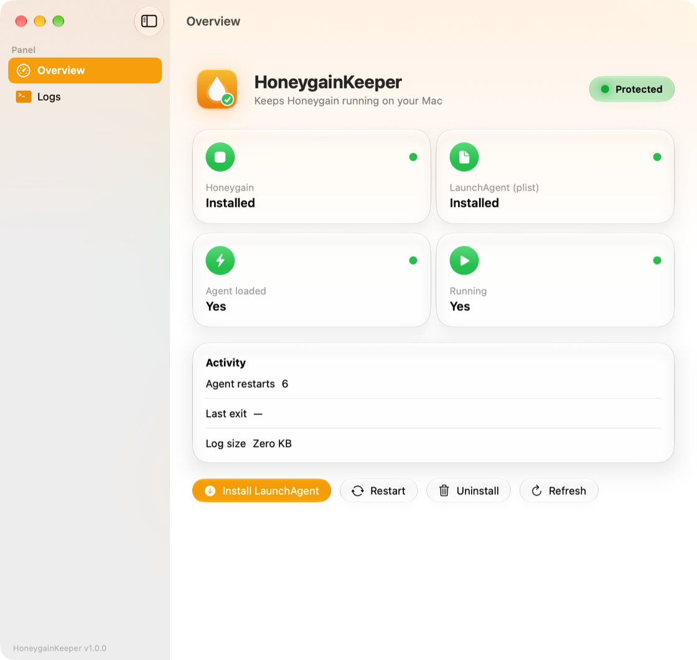
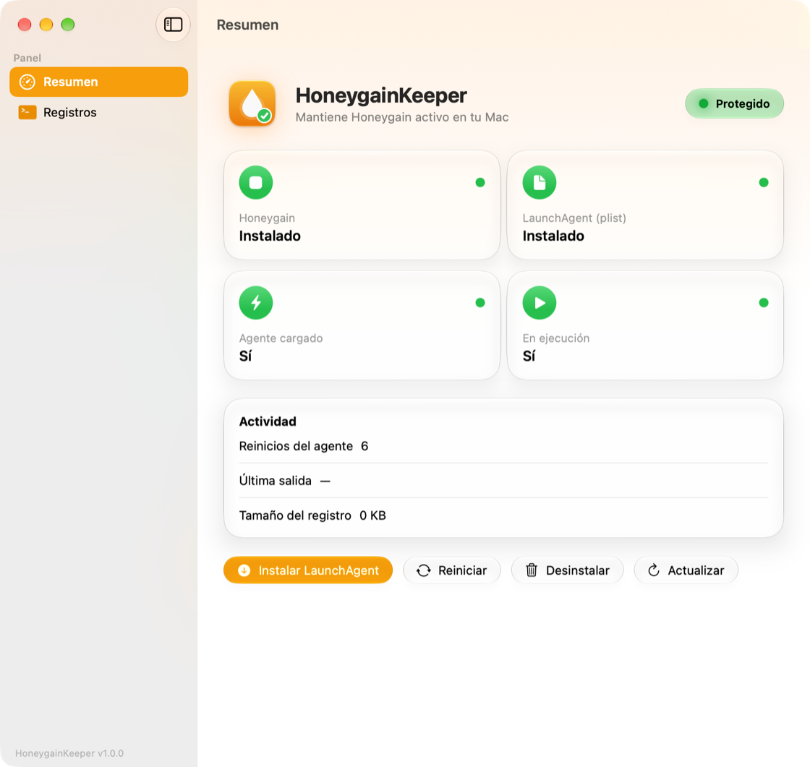

# HoneygainKeeper

**macOS 26+ SwiftUI supervisor for Honeygain's LaunchAgent** — keep-alive so it never dies, one-click official installer with signature verification, crash-loop detection and a built-in log viewer, with a Liquid Glass UI and full bilingual docs (EN/ES).

[](#-requirements)
[](https://swift.org)
[](#-features)
[](https://github.com/YanxReal/HoneygainKeeper/actions/workflows/ci.yml)
[](LICENSE)
[](CONTRIBUTING.md)

> 🌐 **Language:** **English** | [Español](README.es.md)

[Overview](#-overview) • [Features](#-features) • [Requirements](#-requirements) • [Download & install](#-download--install) • [Quick Start](#-quick-start) • [Project structure](#-project-structure) • [Screenshots](#-screenshots) • [How it works](#-how-it-works) • [Make Targets](#-make-targets) • [Security](#-security) • [Troubleshooting](#-troubleshooting) • [Roadmap](#-roadmap) • [Contributing](#-contributing) • [License](#-license)

---

## Table of Contents

1. [Overview](#-overview)
2. [Features](#-features)
3. [Requirements](#-requirements)
4. [Download & install](#-download--install)
5. [Quick Start](#-quick-start)
6. [Project structure](#-project-structure)
7. [Screenshots](#-screenshots)
8. [How it works](#-how-it-works)
9. [Make Targets](#-make-targets)
10. [Security](#-security)
11. [Troubleshooting](#-troubleshooting)
12. [Roadmap](#-roadmap)
13. [Contributing](#-contributing)
14. [License](#-license)
15. [Acknowledgements](#-acknowledgements)

---

## 🔭 Overview

HoneygainKeeper is a native **macOS 26 (Tahoe)** app that supervises **Honeygain** through a **LaunchAgent** (`com.yanx.honeygain-keepalive`): if Honeygain is closed or crashes, launchd brings it back — and this app gives you the controls, live status and logs around it.

| | |
|---|---|
| 🟢 **Keep-alive** | LaunchAgent with `KeepAlive=true`: Honeygain relaunches itself if you quit it |
| 📥 **Official installer** | Downloads Honeygain from its own Sparkle feed and verifies signature + Team ID before installing |
| 📊 **Status dashboard** | Glass cards for app / agent / process state, restart counter, last exit code and log size |
| 🪵 **Log viewer** | Tail of the current + rotated logs with search, follow, copy, export and open in Console.app |
| ⚠️ **Crash-loop detection** | Warns you when Honeygain accumulates repeated error exits |
| 🌐 **Bilingual** | Full UI in English and Spanish with 100% key parity (`Localizable.strings`) |

## ✨ Features

- **Install / uninstall / restart** the LaunchAgent from the app (`launchctl bootstrap` / `bootout` / `kickstart -k`).
- **«Keep always running»** option when installing: ON relaunches Honeygain if you quit it; OFF only opens it at login. The plist is the source of truth; the app remembers your last choice for new installs (ON by default).
- **One-click Honeygain install**: resolves the current DMG from the official Sparkle `appcast.xml`, downloads it with timeouts, mounts it and verifies — `codesign --verify --deep --strict`, **Team ID `L4S6563XXV` (Honeygain UAB)**, bundle ID `com.honeygain.Honeygain` — then checks the binary can run on your Mac (native arm64 or x86_64 + Rosetta) and copies it to `/Applications` off the main thread.
- **Log management**: 256 KB tail, 1000-line cap, live search, follow mode, rotations `.1`–`.3`, safe live truncate and automatic rotation at 5 MB (only while the agent is unloaded — launchd holds the fd while running).
- **Crash-loop banner** when ≥ 5 consecutive error exits are detected.
- **Liquid Glass UI** (macOS 26), single window, tooltips everywhere and dismissable messages right under the header.
- **Energy aware**: 5 s polling in foreground, 30 s in background; downloads and file copies never run on the main thread.
- **Ad-hoc signed, non-sandboxed**: it must write to `~/Library/LaunchAgents` and call `launchctl`. Developer ID signing / notarization is out of scope for now.

## 📦 Requirements

| Requirement | Version | Notes |
|---|---|---|
| **macOS** | 26.0+ (Tahoe) | Liquid Glass APIs |
| **Xcode** | 26+ | Build & run |
| **Swift** | 6 (language mode) | Ships with Xcode 26 |
| **Python 3** | any | Only for `make check` (localization parity) |
| **Honeygain** | optional | The app can download and install it for you |

## 📥 Download & install

Grab the latest build from [Releases](https://github.com/YanxReal/HoneygainKeeper/releases/latest):

| Asset | Use |
|---|---|
| **`HoneygainKeeper-<version>.dmg`** | Recommended — open it and drag the app to **Applications** |
| `HoneygainKeeper-<version>.zip` | Portable app bundle — unzip and move it to Applications |
| Source code | Build it yourself (see [Quick Start](#-quick-start)) |

### First launch (Gatekeeper quarantine)

The app is **ad-hoc signed** (notarization is on the [roadmap](#-roadmap)), so macOS will block
the first launch with a warning like *“Apple could not verify…”* — or even *“HoneygainKeeper is
damaged”*. It is not malware: it is the **quarantine flag** that macOS puts on anything
downloaded from the internet. Remove it with either of these paths:

**A. System Settings (no Terminal):**

1. Double-click the app once and click **Done** on the warning (do **not** move it to the Trash).
2. Open **System Settings → Privacy & Security** and scroll all the way down to **Security**.
3. Click **Open Anyway**, authenticate with Touch ID / password and confirm **Open**.

> The “Open Anyway” button only appears right after a blocked attempt and expires after ~1 hour.

**B. Terminal (works always — required when the warning says “damaged”):**

```bash
xattr -cr /Applications/HoneygainKeeper.app
```

Then open the app normally.

> 💡 The classic right-click → Open bypass no longer exists since macOS 15 — the two paths
> above are the current ones. If you prefer to skip Gatekeeper entirely,
> [build from source](#-quick-start) with `make run`.

## 🚀 Quick Start

```bash
git clone https://github.com/YanxReal/HoneygainKeeper.git
cd HoneygainKeeper

make doctor     # verifies macOS 26+ and Xcode 26+
make run        # builds Debug and launches the app
```

Prefer Xcode? Open `HoneygainKeeper.xcodeproj` and hit ⌘R. The app is ad-hoc signed — no Apple ID or certificates required.

## 🗂️ Project structure

```txt
HoneygainKeeper/
├── HoneygainKeeper.xcodeproj          # macOS 26 app target (Swift 6, shared scheme)
├── HoneygainKeeper/
│   ├── HoneygainKeeperApp.swift       # @main, single-window scene, shared manager
│   ├── ContentView.swift              # sidebar, header, status cards, actions, install popover
│   ├── LogViewerView.swift            # log viewer (tail, search, follow, export)
│   ├── LaunchAgentManager.swift       # plist template, launchctl, state polling, logs
│   ├── HoneygainInstaller.swift       # official installer (feed, download, verification)
│   ├── ProcessRunner.swift            # deadlock-safe process execution off the main actor
│   ├── es.lproj/Localizable.strings   # Spanish (source language)
│   └── en.lproj/Localizable.strings   # English (mirror, same keys)
├── scripts/check_localization.py      # es/en parity + code key-coverage check
└── docs/images/                       # screenshots used by the READMEs
```

## 🖼️ Screenshots

| Overview (English) | Overview (Español) |
|---|---|
|  |  |

## 🔌 How it works

Everything the app manages lives in three fixed locations (no hidden state):

| What | Where |
|---|---|
| LaunchAgent plist | `~/Library/LaunchAgents/com.yanx.honeygain-keepalive.plist` |
| Honeygain app | `/Applications/Honeygain.app` (`Contents/MacOS/Honeygain` via `CFBundleExecutable`) |
| Service log | `~/Library/Logs/honeygain-keepalive.log` (+ `.1`–`.3` rotations) |

The plist runs Honeygain with `RunAtLoad=true` and `KeepAlive` set to your choice:

```xml
<key>Label</key><string>com.yanx.honeygain-keepalive</string>
<key>ProgramArguments</key>
<array>
  <string>/Applications/Honeygain.app/Contents/MacOS/Honeygain</string>
</array>
<key>RunAtLoad</key><true/>
<key>KeepAlive</key><true/>
```

State is read with `launchctl print gui/$UID/com.yanx.honeygain-keepalive`, the plist and the process table; **Restart** is a single `launchctl kickstart -k`.

## 🧰 Make Targets

| Target | What it does |
|---|---|
| `make doctor` | Checks macOS 26+, Xcode 26+ and Python 3 |
| `make build` | Builds the app in Debug (`build/DerivedData`) |
| `make release` | Builds the app in Release |
| `make dist` | Builds Release and packages `dist/HoneygainKeeper-<version>.{dmg,zip}` (for GitHub Releases) |
| `make run` | Builds and launches the app |
| `make check` | Localization parity check + Debug build (what CI runs) |
| `make logs` | Follows the service log (`tail -f`) |
| `make agent-status` | Shows the LaunchAgent state in launchd |
| `make open` / `make clean` | Opens the project in Xcode / removes build artifacts |

## 🔐 Security

- **Every download is verified** before anything is copied to `/Applications`:
  `codesign --verify --deep --strict`, **Team ID `L4S6563XXV` (Honeygain UAB)** and bundle ID `com.honeygain.Honeygain`. A valid-but-foreign signature is rejected too.
- The download host is **pinned** to `resources.honeygain.com` over HTTPS, and every request has timeouts (60 s request / 15 min resource).
- The app is **not sandboxed** (it writes `~/Library/LaunchAgents` and runs `launchctl`) and is **ad-hoc signed**; build it from source.
- Please report vulnerabilities privately — see [SECURITY.md](SECURITY.md).

## 🩺 Troubleshooting

| Symptom | What to do |
|---|---|
| *“Apple could not verify…”* or *“is damaged”* on first launch | It's the quarantine flag of an ad-hoc signed app — see [Download & install](#-download--install) |
| «Service installed but not active yet» | `make agent-status`; uninstall and reinstall from the app; check the Logs panel |
| Honeygain install fails with a network error | Check your connection to `resources.honeygain.com` or use the manual download from honeygain.com |
| Status pill shows «Stopped» | The agent is not loaded: install it from the app (`launchctl bootstrap` is executed for you) |
| Intel Mac + missing Rosetta | The official feed may ship arm64-only builds; install Rosetta or download Honeygain from its website |
| Log shows nothing after a restart | Honeygain buffers stdout in memory; lines appear when it flushes — this is normal |

## 🗺️ Roadmap

- [ ] Unit tests for the plist template, plist diffing and log tail parsing
- [ ] Developer ID signing + notarization (out of scope for now)
- [ ] Manual `.dmg` picker fallback when the feed is unreachable
- [ ] Optional menu-bar mode with quick actions

## 🤝 Contributing

Read [CONTRIBUTING.md](CONTRIBUTING.md). Bilingual parity (README.md ↔ README.es.md and `es`/`en` `.strings`) is enforced by `make check` and CI.

## 📄 License

[MIT](LICENSE) © 2026 Yanx Studio

## 🙏 Acknowledgements

- **Honeygain** — for the official Sparkle feed this app resolves downloads from.
- The community `launchd` keep-alive pattern that inspired this app.
